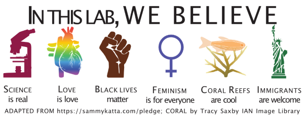
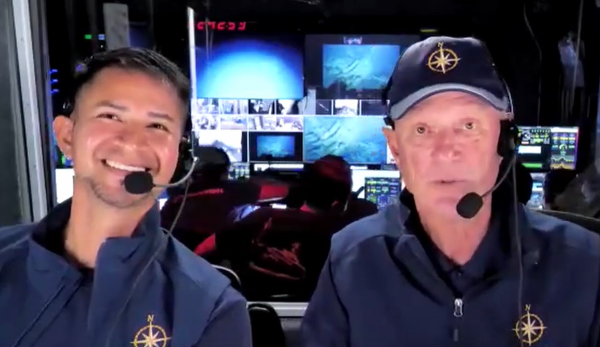

#### Contact Us

  

We are nearly always looking for new ways to understand our changing coastal ecosystems through new collaborations and mentoring new students and postdocs. Please email [Professor Travis](mailto:travis.courtney@upr.edu) to discuss potential collaborations or to join our lab. 

#### Publications

Please see our full list of papers on [Google Scholar](https://scholar.google.com/citations?hl=en&user=hK_DxtUAAAAJ) and email [Professor Travis](mailto:travis.courtney@upr.edu) for copies of any publications listed there.

##### Outreach

 

##### Videos and Media

[Ocean Exploration and Opportunities with Dr. Bob Ballard](https://www.youtube.com/watch?v=G9pe2rmXn1o)

##### Lesson Plans for K-12 Teachers

The following lesson plans were developed for K-12 teachers as part of the Scientific Research and Education Network:

[SciREN 2014: Ocean Acidification Lesson Plan for Grades 9-12](https://github.com/traviscourtney/BiogeochemistryEcologyResearchGroup/raw/main/content/communications/TravisCourtney_SciREN_OceanAcidification.pdf)

[SciREN 2020: Building Coral Reefs Under Climate Change Lesson Plan for Grades 9-12](https://github.com/traviscourtney/BiogeochemistryEcologyResearchGroup/raw/main/content/communications/TravisCourtney_SciREN_CoralReefDisturbances.pdf)

##### Biogeochemistry + Ecology Research Group in the News
[An Interview with Dr. Travis Courtney – Marine Chemist and PLOS Author](https://everyone.plos.org/2022/01/27/an-interview-with-dr-travis-courtney-marine-chemist-and-plos-author/)

[Sloan Research Fellowship awarded to Dr. Travis Courtney](https://www.uprm.edu/portada/2024/03/01/catedraticodecienciasmarinasrecibelabecasloan/)
