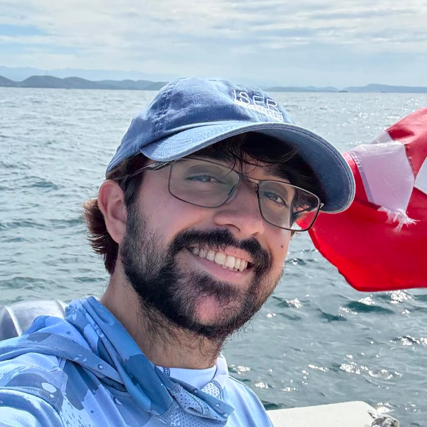

 

Montalvo Negron is interested in quantifying the spectral signals of corals and their gametes to advance detection of coral spawning via remote sensing. He is also growing Ulva seaweed for rearing sea urchins and local restaurants with [ISER Caribe](https://www.isercaribe.org/).

